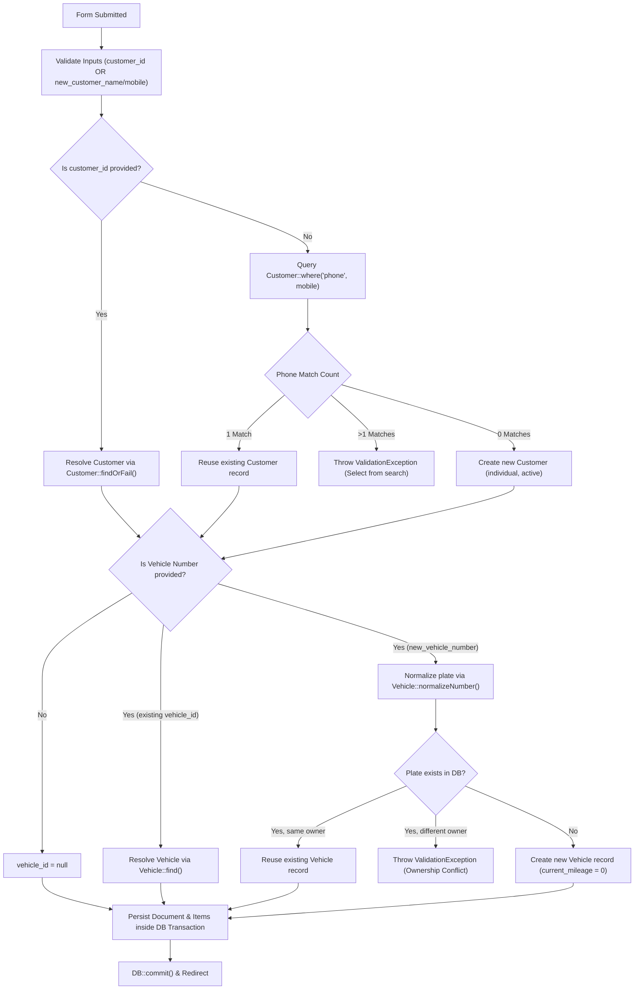

# QA Report: Simplified Customer & Vehicle Entry with Modal Popup in Quotations and Invoices

**Project:** Viran Auto Care Management System  
**Workspace:** `D:\Intern\08\autocare-system`  
**Date:** 2026-10-28  
**Author:** Senior Laravel Blade, Tailwind CSS & Alpine.js Developer  
**Status:** IMPLEMENTED — TESTING NOT RUN (requested by user)  

---

## 1. Executive Summary

This update simplifies customer and vehicle selection across two core billing entry pages:
1. **Create Quotation** (`/billing/quotations/create`)
2. **Create Direct Invoice** (`/operations/invoices/create`)

Key accomplishments:
- **Eliminated duplicate validation error banners** caused by dual rendering in layout (`<x-alert />`) and nested view blocks.
- **Removed Registered Customer vs. Manual / Unregistered toggle tabs**, unifying input into a single searchable customer/vehicle field.
- **Added a centered "+ Add New Customer & Vehicle" modal popup** for fast inline creation of new clients and optional vehicles.
- **Automated customer and vehicle registration on document save**:
  - Automatically matches existing customer records by phone to eliminate duplicates.
  - Generates new `Customer` records when no match exists.
  - Normalizes vehicle registration plates (`Vehicle::normalizeNumber()`), reuses matching plates for the customer, and throws a validation error if a plate belongs to a different owner.
- **Atomic Database Transactions**: All customer, vehicle, document, and item insertions are wrapped in `DB::beginTransaction()` with rollback on failure.

---

## 2. Duplicate Validation Fix Analysis

### Root Cause
In `resources/views/layouts/app.blade.php` (line 25), the application layout renders the global alert component:
```blade
<x-alert />
```
`resources/views/components/alert.blade.php` automatically iterates over `$errors->all()` and renders a styled error banner when validation fails.  
Concurrently, both `billing/quotations/create.blade.php` and `operations/invoices/create.blade.php` included an internal `@if($errors->any())` block directly below the header. When Laravel redirected back with validation errors, the errors rendered twice on screen:
1. First, globally above the breadcrumbs/heading.
2. Second, inside the page body below the heading.

### Resolution
- Removed the local `@if($errors->any())` containers from both `create.blade.php` views.
- The global `<x-alert />` in `layouts/app.blade.php` now serves as the single source of truth for validation feedback.
- Replaced backend generic `"The customer id field is required."` with helpful, context-aware messages:
  - `"Please select an existing customer or vehicle, or add a new customer."`
  - `"Customer mobile number is required when adding a new customer."`
  - `"Vehicle type is required when specifying a vehicle number."`

---

## 3. Searchable Field Implementation Details

### Route & Controller Endpoint
- **Route:** `GET /search/customers-and-vehicles` (`name('search.customers-and-vehicles')`)
- **Controller Action:** `App\Http\Controllers\SearchController::customersAndVehicles`

### Endpoint Behavior & Payload
The endpoint queries both `Vehicle` (with customer and vehicle type relations) and `Customer` tables:
```php
GET /search/customers-and-vehicles?q=CAB
```
Returns a unified JSON payload:
```json
[
  {
    "id": "v_12",
    "customer_id": 5,
    "vehicle_id": 12,
    "customer_name": "Kamal Perera",
    "customer_phone": "0771234567",
    "customer_email": "kamal@gmail.com",
    "vehicle_number": "CAB-1234",
    "vehicle_type": "Car / Sedan",
    "vehicle_type_id": 1,
    "label": "CAB-1234 — Kamal Perera",
    "subtext": "Vehicle: CAB-1234 (Car / Sedan) • Owner: Kamal Perera • Phone: 0771234567"
  },
  {
    "id": "c_5",
    "customer_id": 5,
    "vehicle_id": null,
    "customer_name": "Kamal Perera",
    "customer_phone": "0771234567",
    "customer_email": "kamal@gmail.com",
    "vehicle_number": null,
    "vehicle_type": "",
    "vehicle_type_id": null,
    "label": "Kamal Perera (Customer)",
    "subtext": "Phone: 0771234567 • kamal@gmail.com"
  }
]
```

---

## 4. New Customer & Vehicle Popup Implementation

### Modal Trigger
Beside the Customer & Vehicle card header, users can click:
```html
<button type="button" @click="openNewCustomerModal()">
    + Add New Customer & Vehicle
</button>
```

### Modal Fields & Rules
| Field | Element | Requirement | Placeholder |
|---|---|---|---|
| **Vehicle Number** | Text Input | Optional | `e.g. WP CAB-1234` |
| **Customer Name** | Text Input | **Required** | `Full customer name` |
| **Mobile Number** | Text Input | **Required** | `07XXXXXXXX` |
| **Email Address** | Email Input | Optional | `customer@example.com` |
| **Vehicle Type** | Select Dropdown | **Required if Vehicle Number entered** | `-- Select Vehicle Type --` |

### Client-Side Validation on "Use Details"
1. Verifies `Customer Name` is not empty.
2. Verifies `Mobile Number` is not empty.
3. If `Vehicle Number` is provided, ensures a `Vehicle Type` is selected.
4. If invalid, displays an inline warning banner inside the modal without closing.
5. If valid, populates the main form state, displays the Customer & Vehicle summary badge, populates hidden inputs, and closes the modal.
6. On `Cancel` or `Escape`, closes the modal and preserves existing selections.

---

## 5. Automatic Registration Flow



---

## 6. Transaction Safety & Error Handling

Both `QuotationController::store` and `InvoiceController::store` follow strict database transaction principles:
```php
DB::beginTransaction();
try {
    // 1. Customer resolution / creation
    // 2. Vehicle resolution / creation
    // 3. Document header persistence
    // 4. Line items persistence
    DB::commit();
} catch (ValidationException $ve) {
    DB::rollBack();
    throw $ve;
} catch (\Throwable $e) {
    DB::rollBack();
    return back()->withInput()->with('error', "Failed: {$e->getMessage()}");
}
```
**Guarantees:**
- If document creation fails or line item validation throws an error, any newly created `Customer` or `Vehicle` record is immediately rolled back.
- No partial or orphan records remain in the database.

---

## 7. Quotation Create Page Changes

- Removed duplicate error container below the heading.
- Replaced the two mode tabs (`Registered Customer` vs `Manual / Unregistered`) with:
  1. `SEARCH VEHICLE OR CUSTOMER` input using `/search/customers-and-vehicles`.
  2. `+ Add New Customer & Vehicle` button opening the new centered modal.
  3. Visual summary card displaying Customer Name, Mobile, and Vehicle Number (with `[Change]` button).
  4. Hidden inputs for seamless form submission (`new_customer_name`, `new_customer_mobile`, `new_customer_email`, `new_vehicle_number`, `new_vehicle_type_id`).
- Pre-selection from query parameters (`?customer_id=...&vehicle_id=...`) retained and supported.

---

## 8. Direct Invoice Create Page Changes

- Mirrored all improvements from Quotations to `/operations/invoices/create`.
- Preserved admin authorization checks (`Auth::user()->isAdmin()`).
- Replaced mode selector with the unified search input and `+ Add New Customer & Vehicle` popup.
- Set initial form values based on `old()` input on validation failures to avoid data loss.

---

## 9. Regression Safeguards

The following components were audited and left untouched:
- **Header Action Bar:** Back links, page titles, suggested reference numbers (`$suggestedNumber`).
- **Date Inputs:** Quotation date, Expiry date, Invoice date, Due date.
- **Searchable Line Items:** Searchable service and product pickers implemented in previous task retained without modification.
- **Pricing & Discounts:** Line item discount types/values, document-level discounts, tax calculations, additional charges, and grand totals.
- **Terms & Notes:** Textarea inputs and default terms.
- **Submit Buttons:** Form action buttons and URLs.

---

## 10. Database State Analysis

- **Real `customer_id` Guarantee:** All saved quotations and invoices are guaranteed to link to a valid `customer_id` in `customers`.
- **Zero Phantom / Duplicate Customers:** Phone matching prevents creating duplicate customers for existing clients.
- **Clean Ownership Integrity:** Vehicle normalization ensures vehicles cannot be accidentally assigned to another customer without conflict validation.

---

## 11. Test Cases (Marked as NOT RUN — requested by user)

*Note: Per user instructions, no automated or manual browser tests were run.*

| Test Case | Scenario | Expected Outcome | Status |
|---|---|---|---|
| **TC-01** | Select existing customer without vehicle from search | Document saves with `customer_id`, `vehicle_id = null`. | **NOT RUN — requested by user** |
| **TC-02** | Select existing vehicle from search | Auto-populates `customer_id` and `vehicle_id`. | **NOT RUN — requested by user** |
| **TC-03** | Add new customer + vehicle via popup | Auto-creates `Customer` & `Vehicle` records upon document save. | **NOT RUN — requested by user** |
| **TC-04** | Add new customer without vehicle via popup | Auto-creates `Customer`, saves document with `vehicle_id = null`. | **NOT RUN — requested by user** |
| **TC-05** | Enter existing mobile number in popup (single match) | Reuses existing customer record; avoids duplicate insertion. | **NOT RUN — requested by user** |
| **TC-06** | Enter existing mobile number in popup (>1 match) | Fails validation; requests user to select customer from search. | **NOT RUN — requested by user** |
| **TC-07** | Enter vehicle number already registered to another owner | Fails validation with ownership conflict message. | **NOT RUN — requested by user** |
| **TC-08** | Line item error during submission with new customer/vehicle | Transaction rollback; no new customer/vehicle records saved. | **NOT RUN — requested by user** |

---

## 12. Files Modified & Created

### Routes & Controllers
- `routes/web.php` — Added `GET /search/customers-and-vehicles`.
- `app/Http/Controllers/SearchController.php` — Added `customersAndVehicles()` combined search method.
- `app/Http/Controllers/Billing/QuotationController.php` — Added auto-registration, vehicle conflict check, and transaction safety in `store()`.
- `app/Http/Controllers/Operations/InvoiceController.php` — Added auto-registration, vehicle conflict check, and transaction safety in `store()`.

### Views
- `resources/views/billing/quotations/create.blade.php` — Removed duplicate errors & mode tabs; added unified search, modal popup, summary card, and hidden inputs.
- `resources/views/operations/invoices/create.blade.php` — Removed duplicate errors & mode tabs; added unified search, modal popup, summary card, and hidden inputs.

### Documentation
- `docs/qa/quotation-invoice-customer-vehicle-popup.md` — This QA and architecture report.

